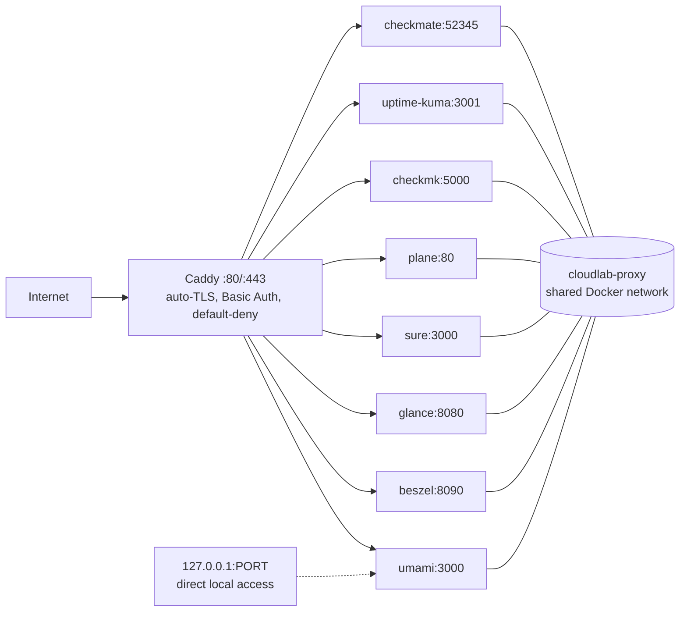

# cloudlab

A cloud lab on a single VPS: a collection of independent services you
activate individually. Run only what you need (one, some, or all) —
each folder is a standalone deployment; `cd` into it, run one command,
get a working app. Anything you don't start costs nothing and gets no
traffic.

**8 apps + Caddy · 1 VPS · 1 command per service · automatic HTTPS.**



## Architecture

All backends join the shared **`cloudlab-proxy` Docker network**. [Caddy](caddy/) is the only
service exposed to the network (ports 80/443) and gives each app a production
domain with automatic HTTPS when you're ready. Localhost port bindings are
kept for direct local access, but Caddy always proxies over the shared
Docker network via container DNS names — never via host ports.

```
internet ──▶ Caddy (:80/:443, auto-TLS) ──▶ app-name:internal-port ──▶ app (cloudlab-proxy network)
                                     └──▶ 127.0.0.1:PORT (direct local access, bypasses Caddy)
```

## Services

There is no master switch and no all-at-once compose file — each service
is activated individually from its own folder (`cd <service> && ./run.sh`)
and runs as its own Docker Compose stack. Stacks share nothing except the
`cloudlab-proxy` network (created automatically) and Caddy, if you want
domains/HTTPS.

| Folder | App | Local URL | Production domain (via Caddy) |
|---|---|---|---|
| [umami/](umami/) | Web analytics | http://localhost:3000 | `analytics.example.com` |
| [beszel/](beszel/) | Server monitoring (hub + agent) | http://localhost:8090 | `monitor.example.com` |
| [glance/](glance/) | Dashboard | http://localhost:8080 | `glance.example.com` |
| [sure/](sure/) | Finance manager | http://localhost:3001 | `sure.example.com` |
| [caddy/](caddy/) | Reverse proxy | — (ports 80/443) | — |
| [plane/](plane/) | Project management | http://localhost:9080 | `plane.example.com` |
| [checkmk/](checkmk/) | Infrastructure monitoring | http://localhost:8072 | `checkmk.domain.dev` |
| [uptime-kuma/](uptime-kuma/) | Uptime monitoring | http://localhost:3002 | `uptime.domain` |
| [checkmate/](checkmate/) | Uptime & infra monitoring | http://localhost:8073 | `checkmate.example.com` |

> Pick either monitor — or both: [Beszel](beszel/) is near-zero
> maintenance with great dashboards, [Checkmk](checkmk/) is the full
> platform (thousands of checks, discovery, escalations, SLA reports).

**In brief:**
- Umami — website visitor analytics
- Beszel — server health (CPU, disks, containers), near-zero maintenance
- Glance — start-page dashboard
- Sure — money tracking
- Plane — project tracking
- Checkmk — deep infrastructure monitoring (checks, discovery, escalations, SLA reports)
- Uptime Kuma — simplest uptime watcher
- Checkmate — uptime plus infra checks, PageSpeed, and status pages
- Caddy — front door giving the others HTTPS domains

> This is a template repo — the domains above are placeholders. All
> Caddy sites require **HTTP Basic Auth by default** (see `caddy/Caddyfile`
> and `caddy/basic-auth.caddy.example`): the browser prompts for a
> username/password before the request reaches the app, which still has
> its own login behind it. `run.sh` generates a strong random password
> on first run. **Tailscale is optional** — add `import tailscale-only`
> to a site for an IP allowlist on top of Basic Auth, or remove
> `import basic-auth` to make a site public.

### Optional: Tailscale (extra IP allowlist, no public DNS)

Basic Auth is the default and works from any browser. If you also want
an IP allowlist — or you don't want public DNS at all — you can add
`import tailscale-only` to a site block (after `import basic-auth`) and
put your tailnet IPs in `caddy/tailscale-ips.caddy`. If the VPS has no
public DNS, map each domain to the **server's Tailscale IP** in your
client's hosts file. Look up the server's Tailscale IP with
`tailscale ip -4` on the VPS, then add one line per site to the hosts
file on your laptop/workstation:

```
100.x.x.x  analytics.example.com
100.x.x.x  glance.example.com
```

- **Windows** (as Administrator): `C:\Windows\System32\drivers\etc\hosts`,
  then `ipconfig /flushdns`.
- **Linux/macOS**: `/etc/hosts`, then restart the browser.

The IP in the hosts file must match the server's Tailscale IP — Tailscale
carries the request over the tunnel, so Caddy sees your device's tailnet
IP as the source and the optional `tailscale-only` allowlist passes. TLS is
unaffected: Caddy still serves the real Let's Encrypt certificate for the
domain, and Basic Auth still prompts first.

## Requirements

- A Linux VPS (or any machine) with [Docker Engine](https://docs.docker.com/engine/install/)
  and Docker Compose v2 (`docker compose version`).
- Ports 80 and 443 free if you run Caddy.

## Usage

Each service folder works the same way (see "Services" above for the
pick-what-you-need model).

**Start / install (one command):**

```bash
cd <service>   # e.g. cd umami
./run.sh
```

`run.sh` creates `.env` from `.env.example` (generating secrets where the app
needs them), pulls the images, starts the stack, and waits until it answers.
It is idempotent — safe to re-run any time.

**Update (one command, per upstream docs):**

```bash
cd <service>
./update.sh
```

Each `update.sh` follows that app's official update procedure (linked at the
top of the script) and waits until the service is back.

**Other common commands** (run inside the service folder):

```bash
docker compose ps            # status
docker compose logs -f       # logs (add a service name to filter)
docker compose down          # stop (data is kept in Docker volumes)
docker compose down -v       # stop AND delete data volumes
```

## Going to production (domains + HTTPS)

1. Point each domain's DNS (A/AAAA record) at the VPS.
2. Keep `import basic-auth` in each site block (default — browser login
   gate; credentials generated by `caddy/run.sh`). Optionally add
   `import tailscale-only` as a second layer (set your IPs in
   `caddy/tailscale-ips.caddy` first), or remove `import basic-auth`
   to make a site public.
3. Uncomment the matching block(s) in [caddy/Caddyfile](caddy/Caddyfile)
   and set your real domain.
4. Reload Caddy without downtime:

```bash
cd caddy
docker compose exec caddy caddy reload --config /etc/caddy/Caddyfile --adapter caddyfile
```

Caddy obtains and renews certificates automatically. Some apps need to know
their public URL — each service README has a "Production domain" section
(e.g. Sure needs `RAILS_ASSUME_SSL=true`, Beszel needs `APP_URL`, Plane needs
`WEB_URL`/`CORS_ALLOWED_ORIGINS`).

## Secrets

Every service keeps runtime secrets in its own `.env`, created from the
committed `.env.example`. `.env` files are git-ignored in every folder —
never commit them. The same goes for Caddy's live auth files:
`caddy/basic-auth.caddy` (Basic Auth users/passwords) and
`caddy/tailscale-ips.caddy` (tailnet allowlist) are generated from
committed `.example` templates and git-ignored. Config that is meant to
be shared (e.g. Glance's dashboard, Caddy's Caddyfile) is committed on
purpose; each README calls this out.

## Backups

Data lives in named Docker volumes (and `plane-app/` for Plane), so it
survives restarts, updates, and `git clone` redeploys. Volume names and
app-specific backup tools are documented per service:

- Umami: `umami-db` volume (plus an `ANALYZE;` tip after major upgrades).
- Beszel: `beszel-data` volume; pairing survives updates.
- Sure: `postgres-data`, `redis-data`, `app-storage` volumes.
- Plane: `plane-app/` dir + volumes; `./setup.sh backup` for full backups.
- Checkmk: `checkmk` volume (whole site; snapshot it, or `omd backup` inside — see checkmk README).
- Uptime Kuma: `uptime-kuma` volume (monitors + history; snapshot it — see uptime-kuma README).
- Checkmate: `mongo-data` volume (snapshot it — see checkmate README).
- Caddy: `caddy-data` (certificates), `caddy-config`; plus the git-ignored
  `basic-auth.caddy` and `tailscale-ips.caddy` files in `caddy/`.
- Glance: stateless; the config in `glance/config/` is the backup.

## Operations

**Disaster recovery:** total-loss rebuild is documented in
[DISASTER-RECOVERY.md](DISASTER-RECOVERY.md) (what lives off-box, backup
commands, rebuild order, Let's Encrypt caveat). Restores are rehearsed on
a spare machine and logged there — latest status: not yet drilled.

**Image policy:** app images track stable release lines
(`sure:stable`, `check-mk-raw:2.4.0-latest`, …) while some stacks use
`:latest`; infrastructure images are pinned (`postgres:16-alpine`,
`mongo:8.0`). `run.sh` pulls on every run, so pin an exact version in
`.env` when you need immutability — otherwise use `update.sh` for
deliberate, one-service-at-a-time upgrades.

**The lab monitors itself** (recommended setup — wire once, sleep well):

- [ ] Uptime Kuma: one monitor per Local URL in the table above, plus
      your main HTTPS domain once live (expects 200 — proves Caddy +
      app + TLS end-to-end in a single probe).
- [ ] Beszel (already running): disk-space and load alerts for the VPS
      in the hub UI.
- [ ] Pick one alerter to avoid double pages during maintenance (see
      "In brief" — overlapping monitors are intentional, overlapping
      wake-ups are not).

**CI:** every push runs [.github/workflows/smoke.yml](.github/workflows/smoke.yml)
— `bash -n` over all scripts, `docker compose config` per stack against
example envs, and a Caddyfile validation. Nothing is deployed from CI;
it only proves the repo is internally consistent.

## Repository layout

```
cloudlab/
├── README.md / CONTRIBUTING.md / CODE_OF_CONDUCT.md / LICENSE
├── caddy/     # reverse proxy (public entry point)
├── umami/     # analytics
├── beszel/    # monitoring
├── glance/    # dashboard (config/ is the dashboard)
├── sure/      # finance
├── plane/     # project management (upstream setup.sh based)
├── checkmk/   # monitoring platform (or use beszel/ for lightweight)
├── uptime-kuma/ # uptime monitoring
└── checkmate/ # uptime & infra monitoring
```

Each service folder contains `compose.yml` (or upstream equivalent),
`.env.example`, `.gitignore`, `run.sh`, `update.sh`, `stop.sh`,
`restart.sh`, and `README.md` with service-specific instructions.
Folders are independent — run and/or copy out one, some, or all (see
"Using this folder as a template" in each service README).

## Contributing

See [CONTRIBUTING.md](CONTRIBUTING.md). Be nice — see
[CODE_OF_CONDUCT.md](CODE_OF_CONDUCT.md).

## License

MIT — see [LICENSE](LICENSE).